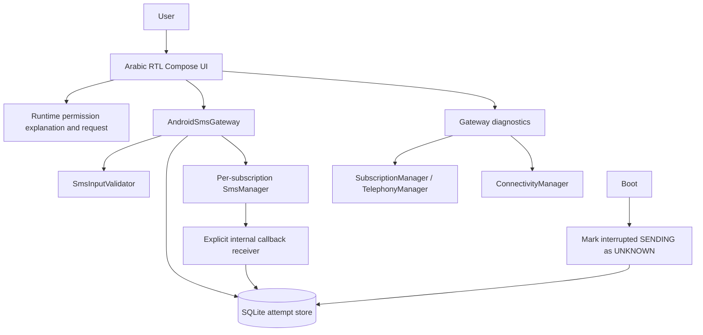
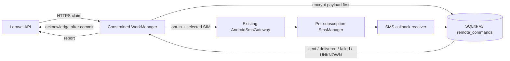
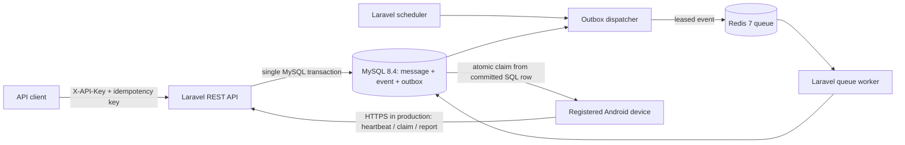

# ALMAZEN SMS Architecture

## Current product (2026-11-12)

The accepted deployment is the current Hostinger plan: MariaDB through Laravel's `mysql` driver, and Laravel Database Queue. Redis is not required. The outbox and the message commit stay in one SQL transaction; the scheduler publishes due outbox rows to the database queue. Diagnostics name that connection `Database Queue` and do not treat a missing Redis service as a fault. Scheduler status is unconfirmed until `scheduler:heartbeat` writes a last-run row. Defining the schedule in Laravel does not prove Hostinger cron is configured.

Each API key has a UTC daily limit and a rolling per-minute limit, edited on the admin website. Effective daily remaining is the minimum of the key's remaining messages and the project's remaining daily ceiling. The ceiling stays so every key on a project shares one budget. Idempotent replays do not consume either counter. Android tells the operator that the server enforces the key quota and does not display a fixed numeric quota.

OTP is per project and disabled by default. Only an administrator can enable it. Request, verify, and cancel are API endpoints. The code is hashed, and the SMS uses the existing message path inside the same transaction as the challenge. Supersede, expiry, cancel, and the claim scanner recall OTP messages before cellular handoff, replace the encrypted body with a non-code placeholder, and suppress pending outbox publication. Android checks `send-authorization` immediately before `SmsManager`; the server atomically reserves a valid OTP message as `sending` before authorizing it, so a competing cancel cannot claim a recall after authorization. If the response is lost, Android reports `UNKNOWN` instead of trying again. The admin OTP page shows a masked phone and status, not the code, the full number, or the message text.

SaaS, billing, payments, and a commercial multi-customer product are out of the current scope. Backups, alerts, and carrier-terms review are out of the current scope. The 72-hour, real-boot, and network-outage tests are deferred to the end of the project.

The sections below keep the phase history. Present-tense claims in those sections that require Redis, exclude OTP, or treat SaaS as current work are superseded by this section.

## Phase 2 scope

The existing `:app` Android application provides a local, manually operated SMS proof of concept. Phase 2 adds durable attempt event history, process/boot recovery to `UNKNOWN`, foreground network-change monitoring, battery/charging diagnostics, and database upgrade coverage. It still has no backend queue, dashboard, OTP flow, inbound SMS receiver, or background sending service. All SMS transmission remains initiated from the review-and-confirm screen by the user.

## Components

- `MainActivity.kt`: Compose screens for gateway status, manual send, and local history. Before sending it displays the selected SIM, complete destination, complete message, and multipart count. User confirmation is a distinct action. A permission grant does not automatically resume/send the pending message. Diagnostics polling is lifecycle-aware and pauses when the Activity is not started.
- `domain/SmsAttempt.kt`: input normalization, number masking, attempt state model, and multipart state reducer.
- `device/GatewayDiagnostics.kt`: permission-gated SIM and carrier checks, service state where permitted by API, and validated Internet connectivity. It reports unknown/unavailable values instead of inferring network availability from SIM presence.
- `platform/AndroidSmsGateway.kt`: isolated send adapter, per-subscription `SmsManager`, input/device checks, a single-send coordinator, unique attempt IDs, explicit sent/delivery callback PendingIntents, and attempt persistence before invoking Android.
- `platform/SmsCallbackReceiver.kt`: internal, unexported callback handling. It records sent-part results and separate carrier delivery reports; temporary status reports remain unresolved.
- `platform/SmsSendCoordinator.kt`: in-process single-flight guard and timeout handling. Timed out attempts become `UNKNOWN`; no automatic resend occurs.
- `data/SmsAttemptStore.kt`: local SQLite history, per-part callback state, and append-only attempt events. Foreign keys are enabled; migration from schema v1 to v2 creates the event table without dropping attempts. It retains only a masked destination, SIM slot, sanitized carrier label, segment count, status, timestamps, and redacted diagnostic detail. It does not store the recipient's full number or message body.
- `platform/BootRecoveryReceiver.kt`: handles `BOOT_COMPLETED` after unlock and marks outstanding `SENDING` attempts `UNKNOWN`. It performs only a short local database transaction; it does not launch an Activity or service and never retries SMS.

## Permissions and privacy

The manifest requests `SEND_SMS` only when the user attempts to use the manual send feature, and requests `READ_PHONE_STATE` when SIM details are needed to select/inspect active subscriptions. `ACCESS_NETWORK_STATE` supports the Internet connectivity indicator. No inbox, contacts, call-log, location, or receive-SMS permissions are requested. The application declares telephony hardware as optional so it can install on devices without SMS hardware.

Sending is gated by the SEND_SMS runtime permission and an explicit review confirmation. Every send attempt uses a subscription selected by the user. The callback PendingIntent is explicit to the app's unexported receiver, uniquely scoped by attempt and segment, and mutable only so Android's telephony framework can attach the delivery PDU and format extras.

`SENT` means Android's sent callback succeeded; it does not mean the recipient received the message. `DELIVERED` is set only after a recognized positive status report. No status report is not evidence of delivery. Some carrier/device formats may not support reports, so absence remains `SENT` or an unresolved state. An ambiguous outcome is never automatically retried.

## Detection limits

- Active subscriptions and SIM slot/carrier details depend on `READ_PHONE_STATE` and Android/carrier exposure.
- SIM state does not prove that SMS service is available. Radio service state can be queried on API 33+ without location data; older versions or permission/API errors are represented as unknown.
- The Internet indicator reflects validated IP connectivity, not the SMS radio/network path.
- Android can return a successful send callback before recipient delivery. Carrier delivery reports may be absent, delayed, unsupported, or use format-specific status values.
- The owner confirmed Phase 1's real SMS was sent via Yemen Mobile and delivered to the receiving handset. This is owner-reported evidence; no recipient number or message content is stored here. Delivery-report callback availability remains unverified.
- `ConnectivityManager` default-network callbacks run only while the Activity is started and are unregistered when it stops. SIM/network diagnostics refresh on foreground lifecycle events and at a 15-second foreground interval. Battery percentage/charging status is read from the system sticky battery intent; no wake lock or polling service is used.
- After process recreation, old `SENDING` records become `UNKNOWN` once the two-minute callback timeout expires. After `BOOT_COMPLETED`, any interrupted `SENDING` records are marked `UNKNOWN` immediately. A force-stopped app may not receive boot broadcasts until launched; activity startup also performs stale-record recovery.
- The manifest contains the boot receiver, but its execution was not confirmed on the Samsung after two actual reboots: no receiver log entry appeared. Boot reconciliation is covered by a simulated instrumentation call only. Treat activity startup's stale-record reconciliation as the verified fallback until the OEM boot delivery is confirmed.
- No WorkManager, Room, foreground service, wake lock, or network library was added. The current product has no backend command queue or unattended work to justify them. SQLite is already durable for the existing local record and avoids replacing the working schema with a new persistence framework.

## Phase 4 Android/backend integration

- `data/GatewayCredentialStore.kt` stores the device bearer credential and local command payloads as AES-GCM ciphertext using Android Keystore; configuration and the SQLite attempt database are excluded from backup/transfer. `domain/GatewayUrlPolicy.kt` permits HTTPS origins only and rejects embedded credentials, query strings, fragments, and API paths.
- `network/GatewayApiClient.kt` implements heartbeat, claim, acknowledge, and status reporting over HTTPS with bounded timeouts, no redirects, and no payload/token logging. `worker/GatewayWorkScheduler.kt` uses network-constrained unique WorkManager work; periodic work has Android's 15-minute minimum and can be delayed. The worker checks permission, selected SIM and service state, waits for the next claim until the operator enables the gateway, and disables the automation after 401/403.
- `data/SmsAttemptStore.kt` migrates SQLite v2 to v3 with a unique remote-message link. The command is encrypted and committed locally before acknowledgment. A local attempt and transition to `SENDING` are transactional and precede `SmsManager`; after ambiguity/restart, the existing attempt is reconciled to `UNKNOWN` and only reported. No automatic resend path exists for `SENDING`/`UNKNOWN` commands.
- The Android adapter remains the existing `AndroidSmsGateway`; it still uses the selected `SmsManager` subscription and callback statuses. Remote requests require explicit in-app opt-in, system `SEND_SMS` permission, a chosen active SIM, a per-device one-minute interval, and backend project quotas (default 20/day, 10 requests/minute per project key; project maximum 1000/day).
- No always-on foreground service, wake lock, root, accessibility, or hidden API is used. WorkManager is best effort and does not provide immediate/24-hour uptime. Android 15+ also limits `dataSync` foreground service runtime, so an all-day service would not provide the claimed guarantee.
- **Unverified deployment boundary:** code was not connected to a live backend because Docker's daemon was unavailable and no public HTTPS host/device credentials were configured. MySQL row locking, Redis/outbox behavior under service restart, TLS proxy, Android heartbeat through the deployed host, real API claim/ack/report, and the 72-hour/reboot/network test remain pending. No real SMS was sent by Phase 4 tests.

## Verified development/device environment

- Android Studio Panda 3 (`2025.3.3`); Android Gradle Plugin `9.1.1`; Gradle Wrapper `9.3.1`.
- Kotlin and Compose compiler plugin `2.2.10`; Jetpack Compose BOM `2024.09.00`.
- Gradle uses Android Studio JBR 21.0.9. Host `java` command reports Java 25.0.2.
- `compileSdk` 36.1, `targetSdk` 36, `minSdk` 26; app ID `com.almazen.sms`.
- Connected Samsung `SM-S928U`, Android 17/API 37, security patch `2026-09-05`.
- ADB properties observed `Yemen Mobile`, SIM state `LOADED,NOT_READY`, radio network type `LTE,Unknown`, airplane mode off. These device properties are observations, not proof SMS is usable.

## Phase 3 backend foundation

The Android app remains unchanged. A separate `backend/` Laravel 13 API is introduced; Phase 3 does not send SMS and does not add Dashboard or OTP functionality.

- Laravel 13.42 / PHP `^8.3`; local PHP 8.3.36 and Composer 2.11.1 were used. Runtime dependencies include Sanctum 4.4 and Predis 3.7.1. Docker setup pins MySQL 8.4 and Redis 7 Alpine. The selected Compose topology has no public database or Redis ports and binds the development API only to loopback.
- Operators are provisioned by `php artisan almazen:user:create`; there is no public registration route. Sanctum bearer tokens authenticate operator actions and expire after 60 minutes; expired token rows are pruned daily. Admin-only user management can list accounts and modify role/status, while preventing self-lockout. Owner scoping is enforced for project, API key, and device routes. Project API keys and per-device bearer credentials are shown once and persisted as SHA-256 hashes. API key creation/revocation, device enrollment/revocation, project creation, and user updates append audit rows.
- `POST /api/v1/messages` validates E.164-shaped destinations and message size, requires `Idempotency-Key`, enforces 10 requests/minute per API key and a project daily quota (default 20, configurable up to 1000), encrypts the full destination and body with Laravel's configured application key, and atomically reserves quota and writes the message, lifecycle event, and outbox event. The key/payload comparison digest is HMAC-SHA-256. A repeated key with the same payload returns the existing ID without consuming quota; a different payload returns HTTP 409.
- The scheduled dispatcher leases due outbox rows and dispatches idempotent Laravel jobs to Redis. If dispatch throws, it releases the lease for another scan. Devices claim from committed MySQL rows under a transaction, so durable accepted work remains queryable if Redis is unavailable. In Phase 3 the queue job records durable queue processing only; Android SMS initiation and end-to-end result reconciliation are Phase 4.
- Message state transitions and append-only event rows are centrally checked. `sent_to_network` means only a device reported platform/network handoff; `delivery_reported` is a separate state. `unknown` is not automatically retried. API/device isolation checks constrain status and claim lookups to the authenticated project/device.
- Production API routes reject non-HTTPS requests. Reverse-proxy TLS termination, trusted-proxy configuration, a public domain, certificates, production secrets, backup/retention policy, and live MySQL/Redis verification remain deployment decisions. `php artisan serve` and the provided Compose file are a local foundation, not production hosting.
- Backend tests use SQLite `:memory:` for portable feature testing. MySQL 8 and Redis 7 services are defined but were not started in this environment because Docker Desktop's daemon was unavailable. SQLite tests do not verify MySQL locking/driver behavior or Redis delivery guarantees.

## Phase 5 web dashboard

The Laravel web entry point redirects to `/admin`; unauthenticated visitors use `/login`. Session login is restricted to active administrators and rate-limited. Each dashboard route uses session authentication and the active-admin guard. Blade pages use RTL Arabic layout and existing Tailwind/Vite assets. The sections cover project ownership/status/daily quota, account roles/status, gateway devices and recent heartbeats, API key prefixes/revocation, message status search, daily project usage, audit events, and a point-in-time database/Redis/outbox/device-health view. State changes use CSRF-protected forms and append audit events.

Secrets are only rendered in their immediate creation response with no-store, no-referrer, and noindex headers; the database persists only their SHA-256 hashes. Dashboard message views use only message IDs/status/attempt count/timestamps; they do not decrypt or display destination/body. Admin bootstrap is through `php artisan dashboard:admin`, which asks for the password through hidden prompts and enforces length/character rules. No self-registration, OTP, or administrative SMS-send action is present. The dashboard has not been deployed; its diagnostics page is an application snapshot and is not an external alerting/monitoring system.

## Hostinger shared-host deployment layout

The hPanel subdomain `api.almazen.online` is listed with public document root `/home/u893896051/domains/almazen.online/public_html/api`. The Laravel application root is to be `/home/u893896051/apps/almazen-sms-api`, outside the web tree. The subdomain document root receives only Laravel `public/` assets plus a front controller pointing to that private root. `.env`, `vendor`, `storage`, migrations, and app source remain outside the web tree. Hostinger CLI PHP 8.3.36 provides `pdo_mysql`, and the server has Composer/rsync/zip utilities; the MySQL server version and hPanel database credentials have not been verified.

On this shared plan, queue, cache, and sessions use MySQL tables. The scheduler invokes the transactional outbox dispatcher once per minute; a bounded queue worker cron processes `outbox` jobs and exits. Android still claims messages from SQL directly. Cron is best-effort and subject to shared-host task/runtime quotas; it is not a daemon or uptime guarantee. Deployment and production traffic remain pending database provisioning, TLS/DNS verification, and live API/device checks.
